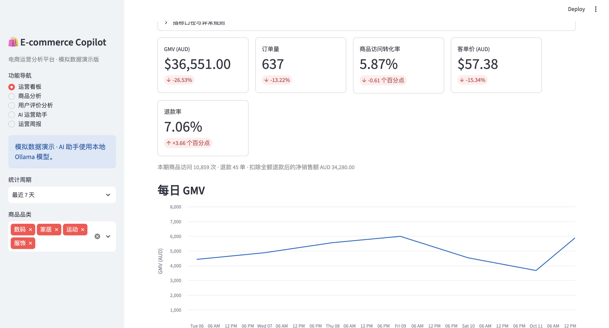
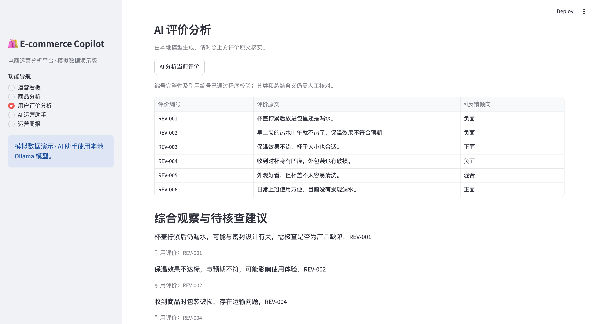
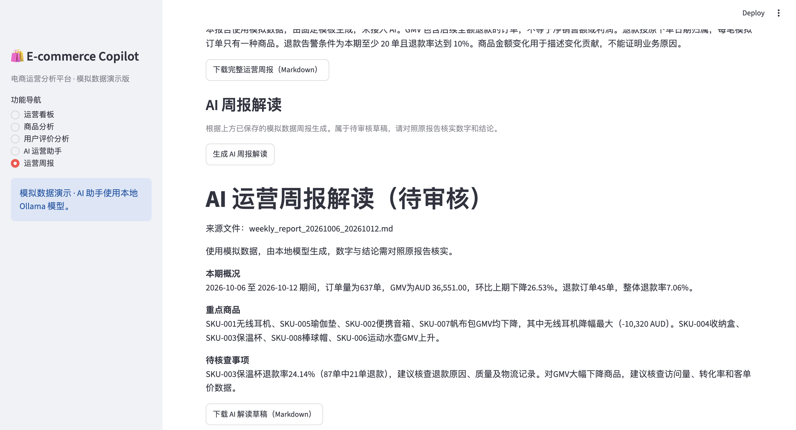

# E-commerce Operations Copilot

基于 Python、Streamlit 和本地 Qwen 模型的电商运营分析作品集项目。

使用模拟订单、商品、流量和用户评价数据，展示从指标计算、异常识别到 AI 辅助解读的完整流程。项目用于学习和面试演示，不代表真实企业经营成果。

## 页面展示

### 运营看板


### 用户评价分析


### AI 周报解读


## 已实现功能

| 模块 | 功能 |
| --- | --- |
| 运营看板 | GMV、订单量、转化率、客单价、退款率，支持时间和品类筛选 |
| 商品分析 | SKU 环比对比、GMV 增减贡献、趋势与规则告警 |
| 用户评价分析 | 评分统计、评价原文、本地 AI 分类及带评价编号的观察建议 |
| AI 运营助手 | 根据程序计算的项目数据回答运营问题 |
| 运营周报 | 展示已保存的报告，生成并下载待审核的 AI 解读草稿 |

## 技术方案

- Python、pandas：数据处理与指标计算
- Streamlit、Plotly：交互页面与图表
- Ollama：本地模型服务
- Qwen3 4B Instruct：中文问答、评价分类与报告解读
- unittest、Streamlit AppTest：自动化测试

核心流程：

CSV 数据 → Python 指标计算与规则判断 → 页面展示
                                      → 本地模型辅助解读

评价数据 → 本地模型 JSON 输出 → 程序校验 → 展示原文与分类

指标和告警由 Python 计算；模型负责解释，生成内容仍需核查。

## 本地运行

以下命令适用于 macOS/Linux，请在项目根目录执行。

### 1. 安装 Python 依赖

项目在 Python 3.13 环境中验证。

```bash
python3 -m venv .venv
.venv/bin/python -m pip install -r requirements.txt
```

### 2. 准备本地模型

安装并启动 Ollama，然后下载项目使用的模型：

```bash
ollama pull qwen3:4b-instruct-2507-q4_K_M
```

模型接口地址为 `http://127.0.0.1:11434/api/chat`。

运行 AI 功能时需保持 Ollama 服务开启。模型在本机推理，不需要付费云端 API Key；首次下载需要网络和磁盘空间，运行速度取决于电脑配置。

### 3. 启动网页

```bash
.venv/bin/python -m streamlit run app.py --server.port 8503
```

打开 http://localhost:8503，保持终端运行。

按 Control+C 停止服务。修改模型调用代码后，若网页仍使用旧配置，可停止并重新启动服务。

## 数据说明

全部为模拟数据，币种为 AUD。

- `data/products.csv`：8 个商品的信息。
- `data/orders.csv`：6,407 笔模拟订单。
- `data/traffic.csv`：480 条商品每日流量记录。
- `data/reviews.csv`：手工构造的模拟用户评价。

订单与流量覆盖 2026-08-14 至 2026-10-12。
“最近 N 天”以数据截止日期计算，而非电脑当天日期。

重建订单、商品和流量数据：

```bash
.venv/bin/python -m src.generate_data
```

此命令会覆盖对应的三个模拟 CSV，不会生成评价数据。

生成检查报告和运营周报：

```bash
.venv/bin/python src/check_data.py
```

报告保存在 `reports/`，是生成时的数据快照；更新数据后需重新生成。

## 指标与告警口径

- GMV：付款订单金额之和，包含后续退款的订单。
- 净销售额：GMV 减全额退款金额，不等于利润。
- 转化率：订单数 / 商品访问次数，不是店铺去重访客转化率。
- 客单价：GMV / 订单数。
- 退款率：全额退款订单数 / 订单数，归属原下单日期。
- 环比：与紧邻的等长上一期间比较。
- 分母为零时不生成有效比率；上期为零时不计算增长百分比。

告警规则：

1. 上期至少 20 单，且 GMV 下降至少 20%。
2. 两期各至少 200 次访问，且转化率下降至少 1 个百分点。
3. 本期至少 20 单，且退款率达到 10%。

规则告警是排查入口，不是原因诊断或统计显著性检验。

## AI 输出校验与限制

评价分析使用 JSON 模式，并检查：

- 每个输入评价编号恰好出现一次。
- 分类属于正面、负面、混合或中性。
- 综合观察引用的评价编号存在。
- 返回内容可以解析，且结构符合要求。

评价原文从原始数据展示，不由模型重新编写。

程序校验只能检查结构和编号，不能保证分类或总结含义正确。
评价未关联具体退款订单，不能直接认定为退款原因。

AI 运营助手每次独立提问，使用数据截止日最近 7 天的全部商品数据，不受运营看板筛选影响。

当前没有实现多轮上下文、RAG 或模型自主工具调用。AI 周报属于待审核草稿，数字和结论需要对照原报告核实。

## 自动化测试

```bash
.venv/bin/python -m unittest discover -s tests -v
```

当前 9 项测试已在开发环境运行通过，覆盖：

- 金额、汇总比率和时间序列计算。
- 空数据、零基线与最小样本规则。
- 模拟数据完整性和预设异常场景。
- 看板、商品分析、周报的页面切换与筛选。
- 评价分析的正常结构、遗漏或重复编号、未知引用及无效 JSON。

评价校验测试模拟模型输出，不需要调用 Ollama。
这些测试不代表对模型回答准确率的全面评测。

## 面试演示流程

1. 运营看板：展示最近 7 天整体表现。
2. 商品分析：查看无线耳机的 GMV 下降及保温杯的退款告警。
3. 用户评价分析：选择保温杯，展示原文、AI 分类及引用编号。
4. AI 运营助手：询问本期表现和需要关注的商品。
5. 运营周报：展示原报告、生成 AI 解读并下载 Markdown。

演示数据核对点：

- 本期：2026-10-06 至 2026-10-12。
- 订单量：637 单。
- GMV：AUD 36,551，环比下降约 26.53%。
- 整体退款率：约 7.06%。
- 保温杯：87 单、21 单退款，退款率约 24.14%。

## 项目定位

本项目展示数据口径设计、规则分析、本地模型集成、输出校验和交互应用开发能力。

尚未包含生产部署、用户权限、真实业务数据接入或生产级监控。